<p align="center">
  
</p>

# 🎬 Awesome AI Video Watermark Remover

<p align="center">
  <a href="https://github.com/ishandutta2007/Awesome-Awesome-Awesome"></a><a href="https://discord.gg/jc4xtF58Ve"></a><a href="https://github.com/ishandutta2007/Awesome-AI-Video-Watermark-Remover/stargazers"></a><a href="https://github.com/ishandutta2007/Awesome-AI-Video-Watermark-Remover/network/members"></a><a href="https://github.com/ishandutta2007/Awesome-AI-Video-Watermark-Remover/issues"></a><a href="LICENSE"></a><a href="https://github.com/ishandutta2007/Awesome-AI-Video-Watermark-Remover/pulls"></a><a href="https://github.com/ishandutta2007"></a>
</p>

---

## 🌟 Overview & Core Focus

A curated directory and guide to the best **AI Video Watermark Remover** technologies, **Video Inpainting** foundation models, and **Object Removal** systems.

This repository tracks cutting-edge **SaaS platforms** and **open-source GitHub repositories** designed to erase logos, hardcoded subtitles, timestamps, overlays, and branding from video clips. These solutions leverage deep neural networks—including Large Mask Inpainting (LaMa), flow-guided feature propagation, optical flow alignment, and spatial-temporal transformers—to reconstruct underlying pixels seamlessly across consecutive frames while preserving **temporal consistency** without flicker or ghosting artifacts.

> 🔍 **SEO & Search Keywords**: AI video watermark remover, video inpainting, remove watermark from video online, AI logo eraser, remove subtitle from video, open-source video inpainting, temporal consistency, ProPainter, IOPaint, LaMa inpainting video, E2FGVI, Sora watermark remover, TikTok watermark remover, deep learning video restoration.

---

## 📑 Table of Contents

- [📈 Sector Overview & Market Dynamics](#-sector-overview--market-dynamics)
- [🏢 SaaS & Hosted Platforms](#-saas--hosted-platforms)
- [💻 Open-Source GitHub Projects](#-open-source-github-projects)
- [🔬 Core Inpainting Technologies Explained](#-core-inpainting-technologies-explained)
- [❓ Frequently Asked Questions (FAQ)](#-frequently-asked-questions-faq)
- [🤝 How to Contribute](#-how-to-contribute)
- [⚖️ Legal Disclaimer](#️-legal-disclaimer)
- [⭐ Star History](#-star-history)
- [☕ Support & Sponsorship](#-support--sponsorship)

---

## 📈 Sector Overview & Market Dynamics

The global AI video editing, restoration, and inpainting market is valued at approximately **$1.15 billion in 2025** and is projected to expand to **$4.8 billion by 2031**, progressing at a CAGR of **~26.8%**. 

The sector displays **moderate fragmentation**:
- **High-Tier Creative Suites**: Multimodal generative AI pioneers (Runway, Adobe/Topaz Labs, Wondershare) capture enterprise and creative agency pipelines where watermark removal is embedded into holistic video production, upscaling, and generative inpainting workflows.
- **Mid-to-Lower Tier Utilities**: Highly fragmented across dozens of independent SaaS utilities, browser extensions, and desktop tools that compete aggressively on single-click simplicity, batch conversion speed, and localized pricing.
- **Market Concentration**: It is **not a winner-take-all** market. Switching costs for simple static watermark removal remain low, but deep moats are rapidly forming around proprietary spatio-temporal foundation models capable of eradicating dynamic, semi-transparent, moving watermarks on complex textured backgrounds without temporal flickering.

---

## 🏢 SaaS & Hosted Platforms

The table below catalogs leading commercial AI video watermark removal and video editing services, sorted descending by **Company Size (Valuation / Revenue)**.

| 🚀 Platform | 🏢 Developer / Company | 📊 Company Size (Valuation / Revenue) | 💳 Starting Paid Tier Price | 🎁 Free Tier / Trial Limits | 🧠 Removal Technique / Engine | 🎯 Best For |
| :--- | :--- | :--- | :--- | :--- | :--- | :--- |
| **[Runway](https://runwayml.com/)** | Runway AI, Inc. | **$5.3B Valuation** (~$200M ARR) | **$12 / user / month** *(Standard annual, or $15/mo monthly)* | **125 one-time generation credits**, max 3 video projects, 720p export, 5 GB cloud storage | Gen-2 / Gen-3 Alpha Inpainting & Multi-Motion Brush | Enterprise-grade generative video inpainting & complex object replacement |
| **[Wondershare Filmora](https://filmora.wondershare.com/)** | Wondershare Tech *(SZSE: 300624)* | **~$1.4B Market Cap** (~$215M Annual Revenue) | **$29.99 / quarter** *(or $49.99/year cross-platform)* | **Free forever plan** with all editing tools; exports carry prominent Filmora watermark & capped at 1080p *(3-day watermark-free trial via referral/promotions)* | AI Object Remover & Smart Cutout Inpainting | Desktop creators requiring video editing with integrated AI object erasure |
| **[Media.io](https://www.media.io/)** | Wondershare Tech *(SZSE: 300624)* | **~$1.4B Market Cap** *(Parent Wondershare)* | **$9.99 / month** *(or $69.99 / year Basic)* | **Free plan includes 10 credits upon registration**, 500 MB max file size, 1080p export, max 2 video exports / day | Browser-based deep learning patch inpainting | Quick online watermark & text removal from short video clips |
| **[VEED.IO](https://www.veed.io/tools/remove-watermark-from-video)** | VEED Limited | **~$160M–$400M Valuation** (~$55M ARR) | **$12 / user / month** *(Lite annual, or $24/mo monthly)* | **Free forever plan** allows exports up to 10 minutes with VEED watermark, 720p maximum resolution, 1 GB upload limit, 30 min auto-subtitles/mo | Video cropping, blur masks & element overlay fill *(Non-inpainting)* | Fast social media video resizing & overlay-based logo concealment |
| **[Topaz Video AI](https://www.topazlabs.com/topaz-video-ai)** | Topaz Labs *(Adobe ecosystem)* | **~$100M–$200M Valuation** (~$35M–$50M Revenue) | **$299 one-time license** *(includes 1 yr upgrades, or $24.99/mo cloud)* | **30-day free trial** with unrestricted local AI model rendering; all exported files carry permanent Topaz watermark *(requires licensed re-render)* | Motion-compensated deep temporal reconstruction & upscaling | Archival video upscaling, artifact reduction & cinema-grade restoration |
| **[Kapwing](https://www.kapwing.com/)** | Kapwing, Inc. | **~$50M–$80M Valuation** (~$12M ARR) | **$16 / member / month** *(Pro annual, or $24/mo monthly)* | **Free forever plan** allows video exports up to 4 minutes at 720p with corner Kapwing watermark; max 3 exports / month, 250 MB asset upload | Bounding-box cropping, geometric overlays & blur filters | Collaborative cloud video editing & bottom-banner watermark cropping |
| **[Apowersoft Watermark Remover](https://www.apowersoft.com/watermark-remover)** | Wangxu Technology Co., Ltd. | **~$40M–$60M Est. Valuation** (~$30M+ Revenue) | **$19.95 / month** *(or $39.95/year, $59.95 lifetime)* | **Free trial allows processing 3 videos or 3 images**, maximum 10 MB per file, and maximum 1-minute video duration | Mosaic blurring, matte filling & edge pixel interpolation | Batch desktop removal of static stamps and date marks on standard videos |
| **[HitPaw Video Watermark Remover](https://www.hitpaw.com/watermark-remover.html)** | HitPaw Co., Ltd / Tenorshare | **~$30M–$50M Est. Valuation** (~$20M–$35M ARR) | **$9.99 / month** *(or $19.99/year, $49.99 lifetime)* | **Free online tier** processes clips up to 500 MB with HitPaw watermark; desktop free trial provides full-frame preview with 1 free export up to 1 min | AI Model Inpainting, Matte Fill, Gaussian Blur, Motion Prediction | Creators dealing with moving, fading, or multi-corner logos |
| **[123Apps Video Cutter](https://online-video-cutter.com/id/remove-logo)** | 123apps LLC | **~$10M–$20M Est. Valuation** (~$5M–$10M Revenue) | **$5.00 / month** *(Premium annual, or $8/mo monthly)* | **Free forever plan** allows up to 10 video operations per day with 500 MB max file size, 720p output, ad-supported interface | Edge-pixel blur interpolation & selective coordinate cropping | Simple browser-based, zero-installation quick logo removal |
| **[Video Watermark Remover Online](https://www.videowatermarkremover.com/)** | Independent Micro-SaaS | **<$5M Est. Valuation** (~$1M–$2M Revenue) | **$9.99 / month** *(Basic tier for 5 video cleanings/month)* | **Free trial allows uploading & previewing 1 video clip** up to 50 MB; full unblurred export requires account activation | Automated multi-frame background blending | Casual users wanting automated web-based watermark scrubbing |

---

## 💻 Open-Source GitHub Projects

The open-source ecosystem provides state-of-the-art neural architectures, zero-cost CLI utilities, and complete desktop apps. Sorted descending by **GitHub Star Count** ⭐.

| 📦 Repository | ⭐ Stars | 🛠️ Architecture / Foundation | 🎯 Key Capabilities & Use Cases |
| :--- | :--- | :--- | :--- |
| **[Sanster/IOPaint](https://github.com/Sanster/IOPaint)** | [](https://github.com/Sanster/IOPaint/stargazers) | SOTA Inpainting Suite (LaMa, MAT, FcF, Manga, Stable Diffusion) | The leading open-source inpainting engine. Powers static watermark removers with browser-based interactive brush, batch processing, and GPU acceleration. |
| **[advimman/lama](https://github.com/advimman/lama)** | [](https://github.com/advimman/lama/stargazers) | Resolution-robust Large Mask Inpainting (Samsung AI) | Foundation model for modern watermark removal. Employs fast Fourier convolutions (FFCs) for high perceptual quality on large mask regions. |
| **[geekyutao/Inpaint-Anything](https://github.com/geekyutao/Inpaint-Anything)** | [](https://github.com/geekyutao/Inpaint-Anything/stargazers) | Segment Anything (SAM) + STTN / LaMa + OSTrack | *Remove Anything Video* feature: click any logo or watermark in frame 1, and the model tracks and inpaints it throughout the entire video. |
| **[gaomingqi/Track-Anything](https://github.com/gaomingqi/Track-Anything)** | [](https://github.com/gaomingqi/Track-Anything/stargazers) | SAM + XMem + Video Inpainting (E2FGVI) | Interactive tracking and object erasure in videos. High-performance semi-supervised tracking ideal for moving or bouncing watermarks. |
| **[sczhou/ProPainter](https://github.com/sczhou/ProPainter)** | [](https://github.com/sczhou/ProPainter/stargazers) | Dual-Domain Propagation & Spatio-Temporal Transformer (ICCV 2023) | **The gold standard for video inpainting**. Seamlessly eliminates moving watermarks and objects with optical flow guidance and zero temporal flicker. |
| **[zllrunning/video-object-removal](https://github.com/zllrunning/video-object-removal)** | [](https://github.com/zllrunning/video-object-removal/stargazers) | Bounding-Box Optical Flow Inpainting | Draw a simple bounding box around the watermark; automatically tracks and fills pixels across frames. |
| **[HypoX64/DeepMosaics](https://github.com/HypoX64/DeepMosaics)** | [](https://github.com/HypoX64/DeepMosaics/stargazers) | Deep Convolutional Mosaic & Watermark Remover | Automated detection and pixel-level reconstruction of pixelated mosaics, logos, and stamps in video and photo assets. |
| **[D-Ogi/WatermarkRemover-AI](https://github.com/D-Ogi/WatermarkRemover-AI)** | [](https://github.com/D-Ogi/WatermarkRemover-AI/stargazers) | Microsoft Florence-2 + LaMa Inpainting | Purpose-built desktop application designed for AI-generated video watermarks (Sora, Runway, Pika). Features multi-language GUI, CUDA support, and audio preservation. |
| **[MCG-NKU/E2FGVI](https://github.com/MCG-NKU/E2FGVI)** | [](https://github.com/MCG-NKU/E2FGVI/stargazers) | End-to-End Flow-Guided Video Inpainting (CVPR 2022) | 15× faster than legacy flow-based methods. Utilizes deformable convolution and temporal focal transformers for crisp frame-to-frame consistency. |
| **[lixiaowen-xw/DiffuEraser](https://github.com/lixiaowen-xw/DiffuEraser)** | [](https://github.com/lixiaowen-xw/DiffuEraser/stargazers) | Diffusion Model for Video Inpainting | Combines diffusion priors with temporal conditioning to achieve content completeness and high fidelity on complex masked video regions. |
| **[TencentARC/VideoPainter](https://github.com/TencentARC/VideoPainter)** | [](https://github.com/TencentARC/VideoPainter/stargazers) | Video DiT Backbone with Context Control (SIGGRAPH 2025) | Any-length video inpainting and editing framework supporting plug-and-play context conditioning for long video sequences. |
| **[researchmm/STTN](https://github.com/researchmm/STTN)** | [](https://github.com/researchmm/STTN/stargazers) | Spatial-Temporal Transformer Network (ECCV 2020) | Fills missing regions by searching for coherent spatial-temporal patches across all video frames simultaneously. |
| **[hitachinsk/FGT](https://github.com/hitachinsk/FGT)** | [](https://github.com/hitachinsk/FGT/stargazers) | Flow-Guided Transformer (ECCV 2022) | Decouples spatial texture synthesis from temporal flow propagation for high structural precision. |
| **[halfzm/ProPainter-Webui](https://github.com/halfzm/ProPainter-Webui)** | [](https://github.com/halfzm/ProPainter-Webui/stargazers) | Gradio WebUI + ProPainter + Segment-and-Track | Intuitive browser interface for self-hosting ProPainter. Paint watermark masks interactively with real-time feedback. |
| **[m3at/video-watermark-removal](https://github.com/m3at/video-watermark-removal)** | [](https://github.com/m3at/video-watermark-removal/stargazers) | Lightweight OpenCV & Inpainting Pipeline | Clean, zero-bloat CLI utility for stripping static corner watermarks with minimal dependencies. |
| **[FudanCVL/EffectErase](https://github.com/FudanCVL/EffectErase)** | [](https://github.com/FudanCVL/EffectErase/stargazers) | Joint Video Object Removal & Insertion (CVPR 2026) | Specialized in cleanly separating visual effects, floating logos, and lighting overlays from dynamic video backgrounds. |
| **[KKenny0/videowipe](https://github.com/KKenny0/videowipe)** | [](https://github.com/KKenny0/videowipe/stargazers) | Local Subtitle & Watermark Wiper (CLI, Docker, WebUI) | Preview-first local cleaner for hardcoded Chinese/English subtitles and channel watermarks. Ready-to-deploy Docker containers. |
| **[jinwyp/VideoWatermarkerRemover](https://github.com/jinwyp/VideoWatermarkerRemover)** | [](https://github.com/jinwyp/VideoWatermarkerRemover/stargazers) | Python + OpenCV Telea / Navier-Stokes Inpainting | Template-matching watermark locator and automatic subtitle bar inpainter. |
| **[dan64/vs-propainter](https://github.com/dan64/vs-propainter)** | [](https://github.com/dan64/vs-propainter/stargazers) | VapourSynth Native C++ Filter for ProPainter | Enables high-throughput video encoding pipelines (x264/x265) to invoke ProPainter directly inside VapourSynth scripts. |
| **[sharkysan/alpha-aware-watermark](https://github.com/sharkysan/alpha-aware-watermark)** | [](https://github.com/sharkysan/alpha-aware-watermark/stargazers) | Alpha Blending Decomposition + Optical Flow | Solves semi-transparent watermarks by estimating the watermark alpha channel and subtracting it before applying inpainting. |
| **[OzzyLennon/ffmpeg-video-watermark-remover-v2](https://github.com/OzzyLennon/ffmpeg-video-watermark-remover-v2)** | [](https://github.com/OzzyLennon/ffmpeg-video-watermark-remover-v2/stargazers) | FFmpeg Delogo Filter + Automated Segmentation | Zero-cost, 100% offline watermark deletion. Automates single-pass static delogo and multi-pass dynamic moving logo segmentation. |
| **[P4R1H/Kapwing-Logo-Remover](https://github.com/P4R1H/Kapwing-Logo-Remover)** | [](https://github.com/P4R1H/Kapwing-Logo-Remover/stargazers) | Discord Bot + Python MoviePy | Discord bot that strips Kapwing bottom watermarks by automatically cropping the bottom 10% from video and GIF attachments. |

---

### 📦 Specialized CLI & Package Utilities

- **[static-ghost](https://www.npmjs.com/package/static-ghost)** *(NPM / Python)*: Open-source CLI tool for static video watermarks utilizing LaMa inpainting through IOPaint. Features a **crop-and-paste optimization pipeline** (Video → FFmpeg Extract → Crop region → Inpaint region only → Paste back → FFmpeg Reassemble). Processes 10–15× fewer pixels, enabling a 10-minute 1080p video to finish on CPU in ~2 hours instead of 20+. Includes browser-based coordinate picker (`static-ghost pick`), multi-frame differencing autodetection (`static-ghost detect`), and Apple Metal (MPS) acceleration.
- **[FFmpeg Delogo Filter](https://ffmpeg.org/ffmpeg-filters.html#delogo)**: Standard FFmpeg filter suppressing simple logos through bilinear interpolation of surrounding pixels:
  ```bash
  ffmpeg -i input.mp4 -vf "delogo=x=20:y=20:w=160:h=60:show=0" -c:a copy output.mp4
  ```

---

## 🔬 Core Inpainting Technologies Explained

```
┌─────────────────────────────────────────────────────────────────────────────┐
│                       AI Video Inpainting Pipeline                          │
├─────────────────┬───────────────────────────────┬───────────────────────────┤
│ 1. Detection    │ 2. Mask Tracking & Dilation   │ 3. Temporal Inpainting    │
│  • Florence-2   │  • Segment Anything (SAM)     │  • ProPainter (Flow/Attn) │
│  • Frame Diff   │  • XMem / OSTrack             │  • LaMa (FFC Convolutions)│
│  • Manual Coord │  • Morphological Dilation     │  • E2FGVI / STTN          │
└─────────────────┴───────────────────────────────┴───────────────────────────┘
```

1. **Pixel-Interpolation Blurring (`delogo`, Blur Fill)**:
   - Evaluates a perimeter around the target rectangle and blends pixels inward.
   - *Pros*: Instant CPU processing, zero memory footprint.
   - *Cons*: Leaves an obvious cloudy or smudged rectangular patch. Completely fails on detailed textures.
2. **Crop & Aspect Shift**:
   - Crops the frame boundaries (e.g., bottom 10% for Kapwing, or 9:16 to 1:1 cropping).
   - *Pros*: Zero inpainting artifacts; original frame details remain untouched.
   - *Cons*: Destroys video composition, cuts off essential visual information.
3. **Deep Image Inpainting (LaMa, MAT, FcF)**:
   - Employs fast Fourier convolutions with high receptive fields to synthesize plausible textures.
   - *Pros*: Flawless static fills on individual frames.
   - *Cons*: Lacks temporal awareness—applying frame-by-frame creates severe temporal flickering (jitter) when the camera moves.
4. **Flow-Guided Spatio-Temporal Inpainting (ProPainter, E2FGVI, VideoPainter)**:
   - Uses optical flow vectors to track pixels from previous and subsequent frames into the occlusion zone.
   - Employs spatial-temporal attention transformers to fill remaining voids.
   - *Pros*: True photorealistic reconstruction with consistent motion and zero ghosting.

---

## ❓ Frequently Asked Questions (FAQ)

### Q1: How do AI video watermark removers reconstruct occluded pixels?
> Modern AI removers do not just blur or blend boundaries. They analyze surrounding frames across time. By computing optical flow vectors, the algorithm identifies background pixels that were visible in earlier or later frames as the camera or objects moved, propagating those real pixels into the watermark region. For static backgrounds, foundation models like LaMa generate contextually realistic synthesized textures.

### Q2: What causes flickering or "ghosting" artifacts in processed videos?
> Flickering occurs when inpainting models process each frame independently without temporal coherence constraints. Because generative networks may synthesize slightly different textures on each frame, the reconstructed patch rapidly shifts, causing high-frequency visual vibration. Solutions like **ProPainter** and **E2FGVI** enforce dual-domain optical flow propagation across adjacent frames to eliminate this jitter.

### Q3: Can moving or fading watermarks be completely removed?
> Yes. Removing moving or bouncing logos requires a two-stage approach: (1) dynamic mask tracking using models like **Segment Anything (SAM)** or **OSTrack** to track the bounding box across every frame, followed by (2) temporal video inpainting (e.g. ProPainter or E2FGVI). Fading watermarks require morphological mask dilation to ensure faint alpha fringes are completely occluded before inpainting.

### Q4: Which open-source model is best for self-hosting on a GPU?
> - For **video footage with moving camera/backgrounds**: **[ProPainter](https://github.com/sczhou/ProPainter)** provides the highest visual fidelity and temporal consistency.
> - For **static corner logos with minimal compute**: **[static-ghost](https://www.npmjs.com/package/static-ghost)** using **[IOPaint](https://github.com/Sanster/IOPaint)** (LaMa) with crop-and-paste optimization delivers the fastest render times and lowest GPU memory usage.
> - For **automated detection of AI-generated watermarks (Sora, Runway)**: **[WatermarkRemover-AI](https://github.com/D-Ogi/WatermarkRemover-AI)** integrates detection (Florence-2) and removal into an all-in-one desktop app.

---

## 🤝 How to Contribute

We welcome additions, benchmarks, and corrections from researchers, developers, and video engineers!

1. 🍴 **Fork the repository**.
2. 🌿 **Create a descriptive feature branch** (`git checkout -b feature/add-new-model`).
3. 📝 **Add entries** following the tabular format:
   - Include direct links, official company/repo names, transparent pricing, and specific free tier limits.
   - Add the social star badge linking to the repository's stargazers page.
   - Sort into the correct descending position.
4. 🚀 **Submit a Pull Request** with a concise summary of the addition.

---

## ⚖️ Legal Disclaimer

- ⚠️ **Intellectual Property Rights**: This repository is curated solely for educational, archival, and research purposes. Removing watermarks, digital rights management (DRM) indicators, copyright stamps, or author attributions without explicit permission from the rights holder may violate copyright laws and terms of service across multiple jurisdictions.
- 🎬 **Recommended Usage**: Utilize these tools on personal video recordings, licensed media, footage where attribution has been otherwise provided, or public domain archives.
- 🛡️ **No Endorsement**: Listing commercial SaaS or open-source software does not constitute an official endorsement or guarantee of processing quality.

---

## ⭐ Star History

[](https://star-history.dera.page/#ishandutta2007/Awesome-AI-Video-Watermark-Remover&type=date&legend=top-left)

---

## ☕ Support & Sponsorship

Thank you for visiting and supporting the **Awesome AI Video Watermark Remover** repository! If this curated ecosystem guide helped you save hours of editing time, find the ideal open-source inpainting model, or streamline your video pipeline, please consider supporting this project:

- ⭐ **Star this repository** on GitHub to improve discoverability.
- 🍴 **Fork and share** with fellow video creators, ML practitioners, and developers.
- ☕ **Buy me a coffee & become a sponsor**:

<p align="center">
  <a href="https://github.com/sponsors/ishandutta2007">
    
  </a>
  &nbsp;&nbsp;
  <a href="https://github.com/sponsors/ishandutta2007">
    
  </a>
</p>

Your generous sponsorship directly funds the continuous testing, benchmarking, and tracking of new open-source video restoration models.

---

<p align="center">
  <sub>Maintained with ❤️ by <a href="https://github.com/ishandutta2007">Ishan Dutta</a> and the global open-source community.</sub>
</p>
